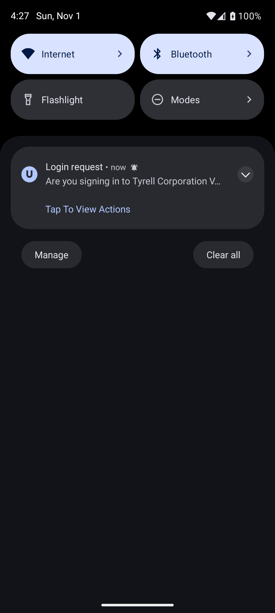
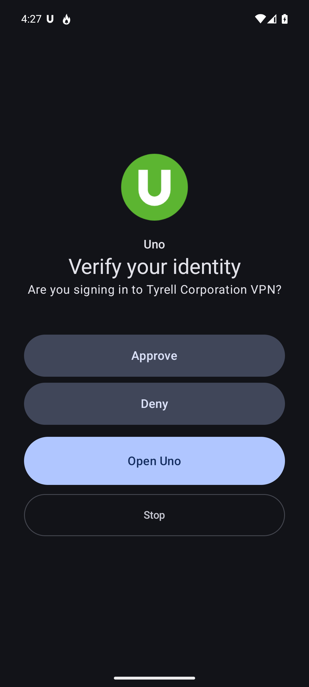
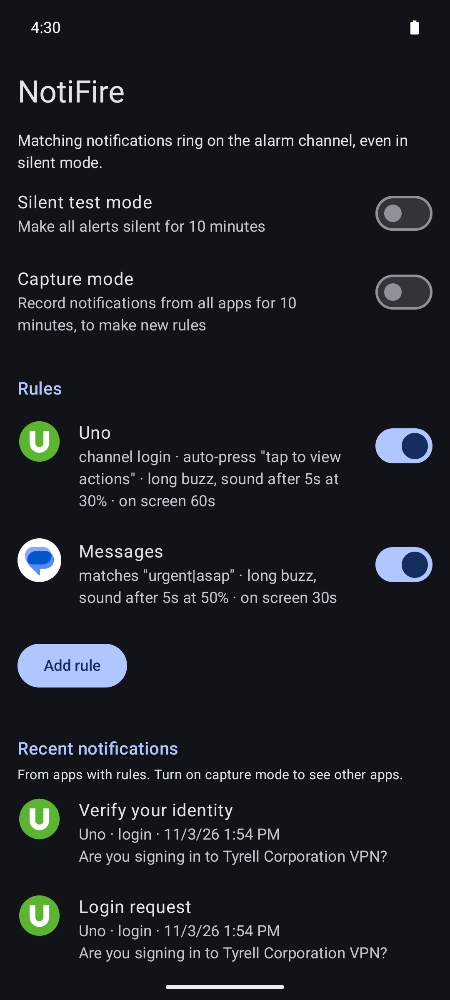
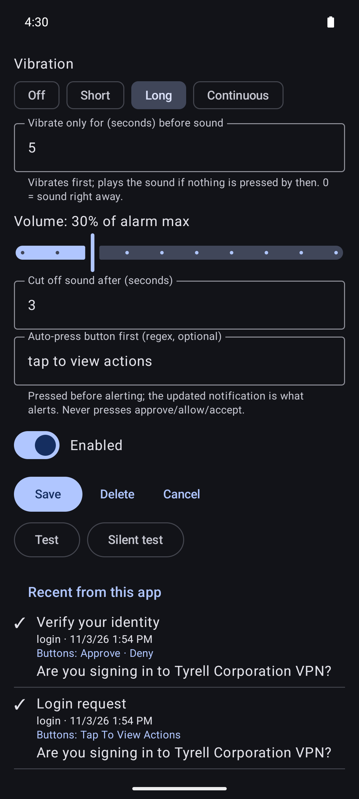
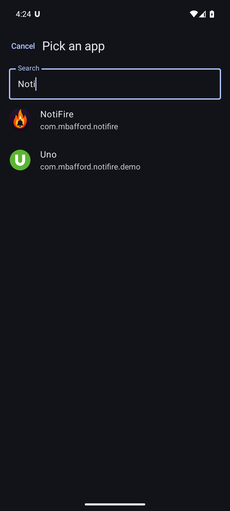

# NotiFire

An Android app that lets chosen notifications get through silent mode. When a notification matches one of your rules, NotiFire plays a short sound on the **alarm** channel (which silent mode leaves alone) and puts a full-screen alert over whatever is on screen, including the lock screen. The alert shows the notification's own buttons, so you can approve a login request in one tap plus your fingerprint.

I built it because two-factor push approvals arrive while my phone is on silent, the push expires, and I get locked out.

| The notification that arrives | What NotiFire shows |
|:---:|:---:|
|  |  |
| A login request with one button, *Tap To View Actions*. Easy to miss on silent. | NotiFire pressed that button itself, played a short alarm, and took over the screen with the real *Approve* / *Deny* buttons. |

<p>
  
  
  
</p>

*Screenshots use **Uno**, the demo two-factor app in [`demo/`](demo), on an emulator.*

## What it does

- **Rules per app.** Pick an app from a searchable list, or tap a recent notification to start a rule from it. You can narrow a rule to one notification channel and/or a regex on the title and text. The editor marks recent notifications from that app with ✓ or ✗ for whether the rule would match them.
- **Gets through silent mode.** The sound plays on the alarm channel at a volume you set per rule (percent of alarm max). Alerts escalate: first a buzz (per rule: off, short, long or continuous), then, if you haven't pressed anything on the alert within a few seconds (5 by default, set per rule), another buzz plus the sound. The sound plays once, and your alarm volume goes back to what it was afterwards. You can pick any system sound or one you've added (see [Custom sounds](#custom-sounds)).
- **Full-screen alert.** It wakes the screen and appears over the lock screen, or over the app you're using. It shows the notification's title, text and **buttons**, plus *Open* (does what tapping the notification does) and *Stop*.
- **Every button asks for an unlock first.** Fingerprint, face or PIN is required before NotiFire presses anything, so nobody holding your locked phone can approve a login.
- **Auto-press** for two-step notifications. Some two-factor apps' first push only has a "Tap To View Actions" button. A rule can press that button automatically, stay quiet, and alert on the updated notification that has *Approve* and *Deny*. Auto-press never presses buttons labeled approve, allow, accept, confirm, grant, yes or verify.
- **The alert follows the notification.** If the source notification is updated, the alert shows the new version; if it's dismissed (say you approved on your watch), the alert closes.
- **Test buttons** in the rule editor: *Test* runs a real alert (vibration and sound) with the unsaved settings; *Silent test* runs it at zero volume with no vibration.
- **Silent test mode** for 10 minutes: alerts still run all the way through, at zero volume with no vibration. It turns itself off.
- **Only looks at apps you have rules for.** Notifications from other apps are dropped immediately, without being read or stored. To set up a rule for a new app, turn on **capture mode**: for 10 minutes NotiFire records notifications from every app so you can tap one to start a rule. When capture ends, entries from apps without a rule are deleted.

Tested on a Pixel running Android 17 with two-factor apps.

## How it works

| Piece | File | Notes |
|---|---|---|
| Notification listener | `AlertListener.kt` | `NotificationListenerService`; ignores apps without a rule (unless capturing), matches rules, auto-presses, forwards updates/removals |
| Alerting | `Alerter.kt` | `Ringtone` with `USAGE_ALARM`, temporary alarm-volume change, alarm-usage vibration, status notification |
| Alert screen | `AlertActivity.kt` | `showWhenLocked` + `turnScreenOn`; sends the notification's `contentIntent` / `actionIntent` after `requestDismissKeyguard` |
| Rules & history | `Store.kt` | Small JSON files in the app's private storage (`files/rules.json`, `files/recent.json`); rules are cached and re-read when the file changes |
| UI | `MainActivity.kt` | Jetpack Compose: rules, app picker, rule editor, recent notifications |

When the phone is unlocked and in use, Android's full-screen notification only shows as a banner. With the **display over other apps** permission, NotiFire opens the alert screen itself and posts a quiet status notification instead.

## Build and install

Requirements: JDK 17+, the Android SDK (platform 37), and a phone with Android 13+ and USB or wireless debugging turned on.

```bash
./gradlew :app:assembleDebug
adb install -r app/build/outputs/apk/debug/app-debug.apk
```

Then grant permissions. You can do this in Settings, or all over ADB:

```bash
P=com.mbafford.notifire
adb shell pm grant $P android.permission.POST_NOTIFICATIONS
adb shell cmd notification allow_listener $P/$P.AlertListener   # Notification access
adb shell appops set $P USE_FULL_SCREEN_INTENT allow              # Full-screen alerts
adb shell appops set $P SYSTEM_ALERT_WINDOW allow                 # Show the alert while the phone is in use
```

There's no need to change the app's battery setting. Android keeps notification listeners running at foreground-service priority, and NotiFire does no background work of its own (no network, jobs, alarms or wake locks). Don't force-stop it, though: that disconnects the listener until you open the app again.

### Release builds

Release APKs are signed with the NotiFire release key (`CN=Matthew Bafford, O=NotiFire`, SHA-256 `25:E9:C1:12:4C:9F:3D:DB:47:67:CA:07:21:49:9B:96:BF:8F:16:A2:19:75:06:A6:C6:08:F1:93:0D:45:98:7A`). The key lives in 1Password; `scripts/build-release.sh` fetches it into a temporary folder for the build and deletes it afterwards:

```bash
scripts/build-release.sh   # needs the 1Password CLI, signed in
```

To sign with your own key instead, pass `-PnotifireKeystore=/path/to/key.p12 -PnotifireKeystorePassword=…` to `./gradlew :app:assembleRelease` (key alias `notifire`).

Two things to know:
- Debug and release builds have different signatures, so switching an installed app between them requires uninstalling first, which deletes its rules. Back up `rules.json` first (see below).
- Release builds aren't debuggable, so the `run-as` commands under [Editing rules over ADB](#editing-rules-over-adb) only work with debug builds.

### Custom sounds

Copy audio files into the phone's `Alarms` folder and have Android index them. They'll then show up in NotiFire's sound picker (and the Clock app):

```bash
adb push mysound.wav "/sdcard/Alarms/My Sound.wav"
adb shell am broadcast -a android.intent.action.MEDIA_SCANNER_SCAN_FILE -d "file:///sdcard/Alarms/My%20Sound.wav"
```

### Editing rules over ADB

Debug builds let you read and write the rules file directly. Read it to your computer first and write it back as a separate step; piping one into the other empties the file.

```bash
adb shell "run-as com.mbafford.notifire cat files/rules.json" > rules.json
# edit rules.json
adb shell "run-as com.mbafford.notifire sh -c 'cat > files/rules.json'" < rules.json
```

```json
[
  {
    "id": "authenticator",
    "pkg": "com.example.authenticator",
    "appLabel": "Authenticator",
    "channelId": "push-requests",
    "pattern": "",
    "autoPress": "tap to view actions",
    "soundUri": "",
    "volumePct": 30,
    "soundSec": 3,
    "escalateSec": 5,
    "vibration": "long",
    "durationSec": 60,
    "enabled": true
  }
]
```

`soundUri`: blank means the default alarm, `"none"` means no sound, anything else is a `content://` URI from the picker. `soundSec` only cuts off long sounds; every sound plays once. `escalateSec` is how long the alert only vibrates before the sound plays (0 = sound right away). `vibration` is `off`, `short`, `long` (default) or `continuous` (keeps buzzing until you press something or the sound ends).

## Demo app: Uno

`demo/` is a tiny stand-in two-factor app for testing without a real push. It copies a common two-step flow: first a "Tap To View Actions" notification, which, once pressed, updates to *Approve* / *Deny*.

```bash
./gradlew :demo:assembleDebug
adb install -r demo/build/outputs/apk/debug/demo-debug.apk
adb shell pm grant com.mbafford.notifire.demo android.permission.POST_NOTIFICATIONS
adb shell am start -n com.mbafford.notifire.demo/.PostActivity --es kind login     # login request
adb shell am start -n com.mbafford.notifire.demo/.PostActivity --es kind message   # ordinary message
```

## Caveats

- It's a sideloaded debug build, not on the Play Store.
- If an app renames its notification channel in an update, rules filtered on that channel stop matching. Check the rule editor's ✓/✗ preview if alerts stop.
- Android doesn't let any app unlock a secured phone, so the alert always asks for your fingerprint or PIN before acting.
- The alert screen only does what the notification's buttons do. If an app needs you to type a code, use *Open*.

## License

MIT. See [LICENSE](LICENSE).
